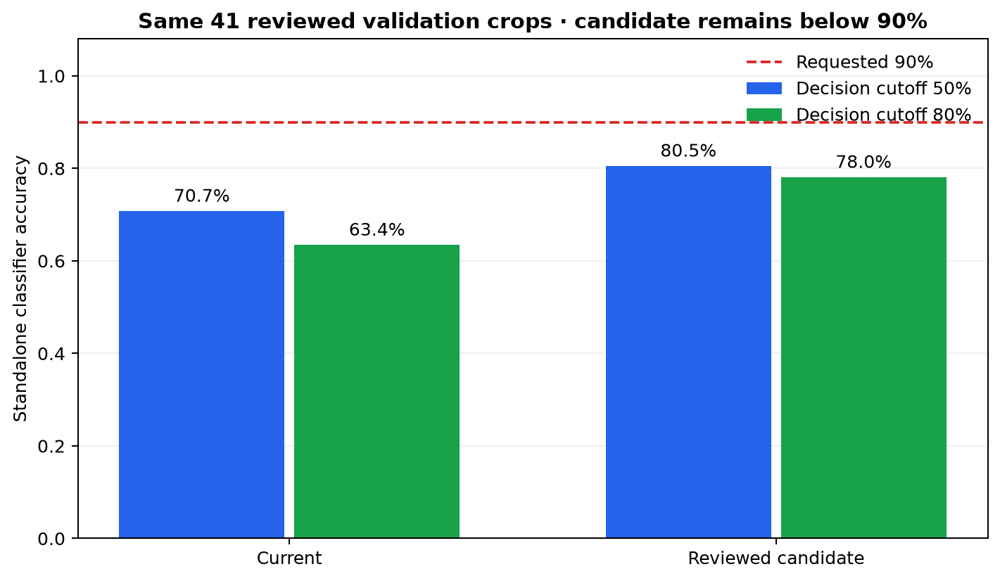

# Reviewed classifier experiment

The requested 90% classifier accuracy was **not reached**. Several source crops labeled as another gesture visibly show thumbs-up hands. The reviewed assignments are recorded in [reviewed_labels.json](../training/reviewed_labels.json); the original dataset remains unchanged. The candidate checkpoint is [thumbs_up_classifier_reviewed_candidate.pt](../models/thumbs_up_classifier_reviewed_candidate.pt).

Both classifiers were evaluated on the same 41 reviewed validation crops. [Raw counts](classifier_experiment_comparison.csv):

| Classifier | Decision cutoff | Correct / 41 | Accuracy | False positives | Misses |
| --- | ---: | ---: | ---: | ---: | ---: |
| Current | 0.50 | 29 | 70.7% | 7 | 5 |
| Reviewed candidate | 0.50 | 33 | 80.5% | 7 | 1 |
| Current | 0.80 | 26 | 63.4% | 6 | 9 |
| Reviewed candidate | 0.80 | 32 | 78.0% | 7 | 2 |

In the end-to-end app at its 0.80 threshold, both classifiers found 26/26 photo-validation boxes and 17/19 webcam boxes. The candidate introduced two false detections on the 61 negative photos; the current classifier had zero. The app therefore still uses the current weights. These small, partly reused sets cannot establish performance on unseen cameras or people.

Recreate the reviewed dataset with `python training/prepare_reviewed_classifier.py` and this comparison with `python training/compare_classifier_experiment.py`.
